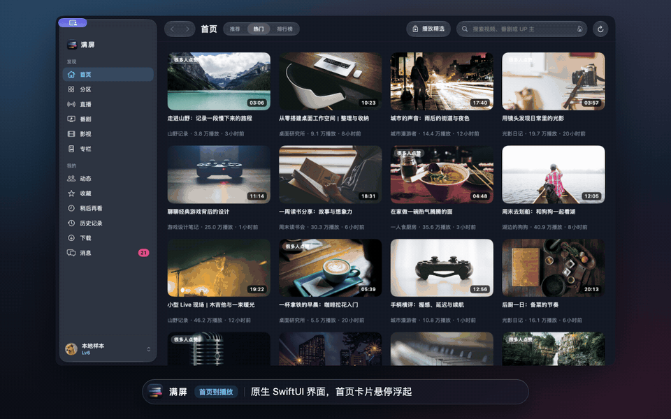
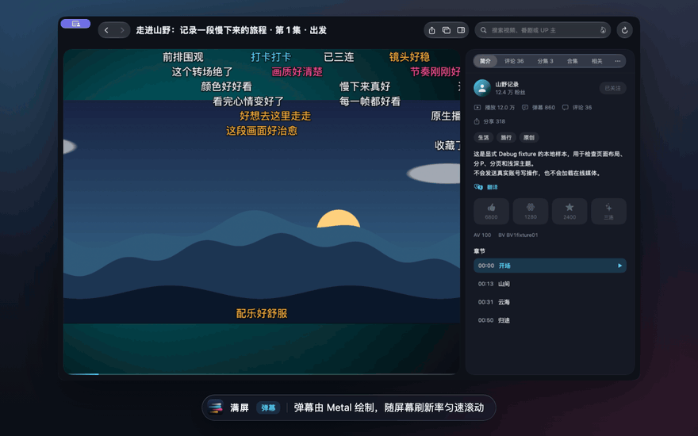
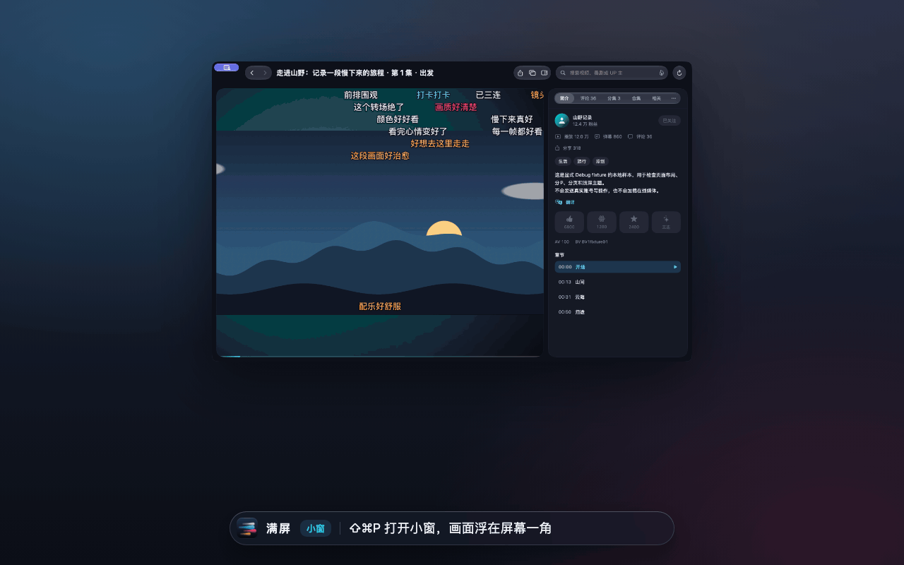
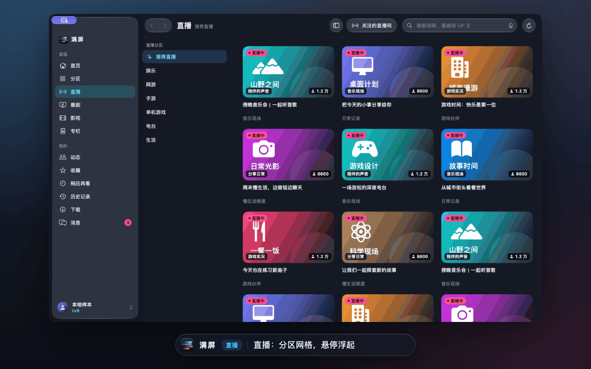
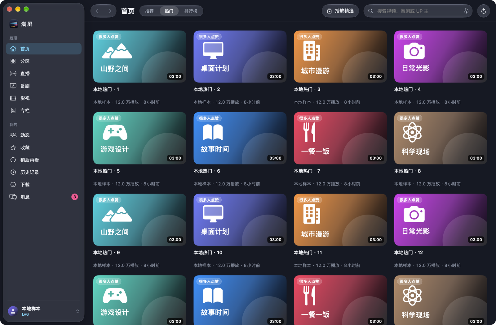
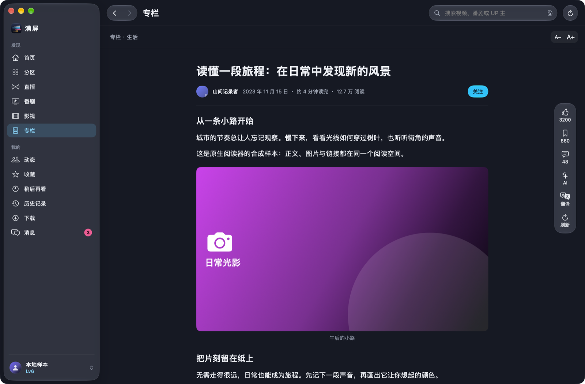
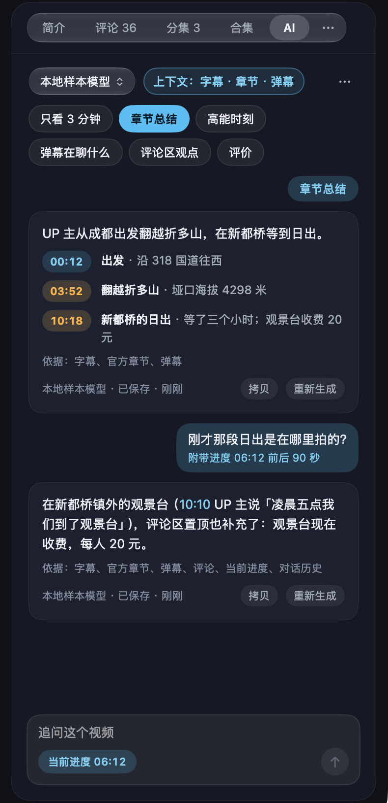

<p align="center"></p>

<h1 align="center">满屏 Manping</h1>

<p align="center">为 Mac 重新打造的第三方哔哩哔哩客户端。<br>
原生 SwiftUI / AppKit 界面、液态玻璃控件、mpv 播放，Metal 弹幕跟随屏幕刷新率匀速滚动。<br>
<sub>A native, unofficial Bilibili client for macOS — SwiftUI/AppKit, Liquid Glass, mpv playback and Metal danmaku.</sub><br>
<sub>当前版本 0.1 · 需要 macOS 27 · Apple 芯片</sub></p>

<p align="center">
  
</p>
<p align="center"><sub>从首页到播放：卡片悬停浮起，播放时控件是一块浮在画面上的玻璃，鼠标静止 2.5 秒后自动隐藏。</sub></p>

> 满屏与哔哩哔哩（上海宽娱数码科技有限公司）没有任何关联，不是官方客户端。视频、弹幕、评论等内容的版权归原作者和平台所有。请遵守哔哩哔哩用户协议与当地法律。

满屏由 Windows 上的开源客户端 [Bili.Copilot（哔哩助理）](https://github.com/Richasy/Bili.Copilot) 移植而来：沿用它的功能范围与界面结构，按 Mac 的习惯重新设计和实现。感谢原作者 [Richasy](https://github.com/Richasy) 和所有贡献者，完整致谢见文末。

| | 做什么 |
|---|---|
| **看视频** | 推荐、热门、排行榜、分区、番剧、影视、专栏；评论、收藏、稍后再看、历史记录、下载 |
| **弹幕** | 独立渲染线程、跟随 ProMotion 120 Hz 的匀速滚动；屏蔽规则可同步账号的云端屏蔽词 |
| **小窗** | 悬浮在所有桌面上的独立小窗，锁定画面比例、吸附屏幕四角，边看边浏览 |
| **直播** | App 内看直播：线路竞速、断线重连、实时弹幕与醒目留言 |
| **网络** | 多节点测速与并发缓冲、卡顿自动换节点；HTTP / SOCKS5 / Shadowsocks 代理 |
| **AI** | 章节总结、只看 3 分钟、高能时刻、弹幕和评论区在聊什么；回答里的时间戳点一下就跳转；22 家服务、ChatGPT 套餐登录、本机 Apple 智能 |

---

## 播放与弹幕

<p align="center">
  
</p>
<p align="center"><sub>弹幕：先画描边再盖填充，同一行不重叠；显示区域、字号、不透明度和速度都可以在播放时调整。</sub></p>

- **播放**：mpv + VideoToolbox 硬件解码，支持 8K、杜比视界、HDR10（EDR 显示）和 120 帧。可以设置画质与编码偏好，有章节、字幕、截取画面、只听声音，按住画面临时倍速；播放时防止屏幕休眠。
- **进度条**：已播放的部分是一条流光；上方的琥珀色曲线是弹幕密度（高能进度），章节处有刻度，悬停时显示预览画面和「时间 · 章节名」。
- **弹幕**：Metal 渲染，在独立线程上按每一帧实际上屏的时刻排位，帧率跟随显示器，与视频本身的帧率无关；滚动、顶部、底部、彩色弹幕可分别隐藏；支持智能屏蔽等级、关键词与正则屏蔽，也可以读取你账号在哔哩哔哩设置的屏蔽词（只读）。
- **播放舞台**：视频页的画面放在一块圆角舞台上，四周是封面虚化后的氛围色；进入视频和直播页时左侧导航自动收起，⌃⌘S 可以临时呼出。
- **全屏**：⌃⌘F 进入真正的沉浸全屏，只剩画面和弹幕；进出全屏时画面和弹幕连续缩放，不会跳动。
- **控制条可以自定义**：在 设置 › 控制条 中拖动图标调整顺序、添加或移除；上方是实时预览，可以拖动预览宽度，看窗口变窄时哪些项目会从左边起依次收进「更多」菜单。
- **画面增强**：内置 Anime4K、ArtCNN、RAVU、nnedi3、FSRCNNX 等 mpv 着色器，在控制条的「更多」菜单 › 画面增强 中选择。
- **番剧**：标注了片头片尾的剧集可以自动跳过，或在播到时显示「跳过片头 / 片尾」。
- **连续播放**：合集、分集和「全部播放」的收藏夹按顺序播放，切换前有 8 秒提示，可以取消。

## 小窗

<p align="center">
  
</p>
<p align="center"><sub>小窗（⇧⌘P）：独立的悬浮小窗，主窗口照常浏览；悬停才出现控件，拖到哪个角就吸附在哪个角。</sub></p>

- 浮在所有桌面空间和全屏应用之上，不占用程序坞和 ⌘Tab；锁定视频比例，宽度可在 320 到 960 之间调整，记住上次的位置。
- 按住画面任意处拖动；松手吸附到最近的屏幕角，按住 ⌥ 则停在原处。单击暂停或继续，双击回到主窗口。
- 小窗里的弹幕按窗口高度缩小，只显示在上半部分，不挡住画面主体。
- 也可以从视频卡片的右键菜单选「小窗播放」，或选「在独立窗口播放」（⌥⌘P）用一个普通大小的独立窗口播放。

## 直播

<p align="center">
  
</p>
<p align="center"><sub>直播：画面、实时弹幕和醒目留言都在 App 内；翻看历史时新弹幕不会打断你。</sub></p>

- 同时测试多条线路，选最快的一条播放；断线后自动重新连接并轮换线路，控制面板显示当前线路和编码。
- 「弹幕」页显示实时弹幕、礼物和醒目留言；「主播」页显示主播信息、在看人数和人气。
- 关注的主播开播时发送系统通知；常看的直播间可以固定到菜单栏图标和 Dock 菜单。

## 内容与阅读

<p align="center">
  
  
</p>

- 侧边栏分「发现」（首页、分区、直播、番剧、影视、专栏）和「我的」（动态、收藏、稍后再看、历史记录、下载、消息）两组；窗口较窄时收成图标栏，⌃⌘S 隐藏。
- 专栏阅读：正文最宽 680，字号可调；评论可以发送、回复和点赞；私信、@ 我的、收到的赞都在「消息」里。
- 下载视频、弹幕和字幕；也可以导出 BBDown 命令交给外部工具。
- 搜索全站，或在历史记录、UP 主空间内搜索；热搜一键直达（⌘K）。

## 网络与代理

- **节点优选**：播放前对候选节点做两阶段测速并选最快的一个；可以同时从多个节点分段缓冲、互为备份；卡顿时自动换节点，网络较差时自动降低一档画质。
- **代理**：HTTP、SOCKS5 和内置 Shadowsocks。可以只在遇到地区限制时让接口走代理，也可以在卡顿时或始终经代理并发拉取视频。修改后要先测试通过才会生效，并显示经代理与直连时的出口位置。

## AI

<p align="center">
  
</p>
<p align="center"><sub>AI 面板：预设一键生成，时间戳点一下就跳到那一刻；追问会自动附带当前进度前后的字幕。</sub></p>

- **预设**：章节总结、只看 3 分钟（挑出最值得看的片段，可以依次播放）、高能时刻（弹幕峰值结合字幕）、弹幕在聊什么、评论区观点、评价、问答；专栏有要点、评价和问答。预设可以编辑、排序、关闭，也可以新建。
- **依据清楚**：每条回答都写明用了哪些材料（字幕、官方章节、弹幕、评论、当前进度）；面板上的「上下文」可以看到这次会发送什么、大约多少 token，并临时关掉某一项。
- **追问**：同一个视频是一条对话，追问时自动带上当前播放位置前后的字幕。
- **服务**：支持 22 家 API 服务（OpenAI、Anthropic、Gemini、DeepSeek、通义千问、豆包、智谱、Kimi 等），也可以用 ChatGPT 套餐账号登录；Apple 智能可用时可以完全在本机处理。
- **只在你点按时发送**，没有配置服务就不会发送任何内容。回答默认保存在本机，可以设置保存期限或完全不保存。

## 设置与致谢

<p align="center">
  
</p>
<p align="center"><sub>设置窗口（⌘,）：通用、播放、控制条、弹幕、网络、下载与截图、通知、隐私、AI、高级十个分类；最下方是「致谢」。</sub></p>

## Mac 体验

- **系统集成**：控制中心与媒体键、Dock 菜单与未读角标、菜单栏常驻图标、系统通知、聚焦搜索看过的内容、接力到其他设备、实况文本（暂停时选取画面文字）、系统翻译。
- **链接直达**：⌘L 打开哔哩哔哩链接（会先读取剪贴板），把链接拖到窗口上，或用 `manping://` 链接（video、episode、season、live、article、space）。
- **省电**：由你决定（设置 › 播放 › 省电，或播放器「更多」菜单）。默认在用电池或机身发热时把弹幕降到最高 60 帧；低电量模式或严重发热时再限制为最多 40 行、舞台背景改为纯色；降低画面处理质量（mpv fast 配置）默认关闭。每一项都可以单独关掉，也可以设为始终省电或完全关闭。省电只调整弹幕和画面处理，不影响解码、加载与缓冲。

### 快捷键

| 操作 | 快捷键 | 操作 | 快捷键 |
|---|---|---|---|
| 播放 / 暂停 | 空格 | 快退 / 快进 | ← / → |
| 上一个 / 下一个 | ⇧⌘[ / ⇧⌘] | 显示弹幕 | ⇧⌘D |
| 小窗 | ⇧⌘P | 在独立窗口播放 | ⌥⌘P |
| 截取画面 | ⇧⌘S | 进入全屏幕 | ⌃⌘F |
| 返回 / 前进 | ⌘[ / ⌘] | 刷新 | ⌘R |
| 首页 … 专栏 | ⌘1 – ⌘6 | 动态 … 消息 | ⌥⌘1 – ⌥⌘6 |
| 搜索 | ⌘F | 热搜 | ⌘K |
| 打开链接 | ⌘L | 显示 / 隐藏侧边栏 | ⌃⌘S |
| 设置 | ⌘, | | |

## 安装

1. 从 [Releases](https://github.com/PIDEAN/Manping/releases) 下载 `满屏.app` 的压缩包并解压，拖到「应用程序」文件夹；或者按下文从源码构建。
2. 发布包用项目自己的固定证书签名，没有经过 Apple 公证。第一次打开时 macOS 会提示无法验证开发者，请在 系统设置 › 隐私与安全性 中点「仍要打开」。
3. 用哔哩哔哩手机 App 扫码登录。登录凭据加密保存在你的钥匙串里，只有满屏能读取。正式版每次更新都使用同一张证书签名，所以登录和升级时都不会弹出钥匙串授权窗口。

## 隐私

满屏没有自己的服务器，不收集任何统计数据。下面这些数据只保存在你的 Mac 上：

| 数据 | 位置 |
|---|---|
| 登录凭据、代理密码、AI 服务密钥、ChatGPT 套餐令牌 | 钥匙串（服务名以 `io.github.pidean.manping` 开头） |
| 设置、固定的直播间与 UP 主、弹幕屏蔽规则、账号屏蔽词缓存 | `~/Library/Preferences/io.github.pidean.manping.plist` |
| AI 服务配置（不含密钥）、下载记录 | `~/Library/Application Support/Manping/` |
| AI 回答与对话 | `~/Library/Application Support/Manping/ai.sqlite`（期限可设，可清除：设置 › AI › 对话与保存） |
| 图片缓存 | `~/Library/Caches/` 下的应用缓存 |
| 聚焦索引（看过的内容，90 天过期） | 系统聚焦；可在 设置 › 隐私 › 聚焦搜索与接力 中关闭并清除 |

### 会发送到外部的数据

满屏只会连接哔哩哔哩的服务器、你自己配置的代理，以及你选择的 AI 服务。下面这些功能会把数据发到本机以外，都可以关闭：

| 功能 | 发送什么、发给谁 | 默认 | 如何关闭 |
|---|---|---|---|
| 同步观看进度 | 登录后，把正在看的视频编号和播放进度写入你的 B 站历史记录 | 开 | 设置 › 隐私 › 同步观看进度 |
| 接力 | 正在看的 B 站网页地址和标题，由系统提供给登录同一 Apple 账户的其他设备 | 开 | 设置 › 隐私 › 聚焦搜索与接力（同时关闭聚焦索引）；或在 系统设置 › 通用 › 隔空投送与接力 中关闭接力 |
| AI 预设与问答 | 只在你点按时发送，按预设需要选取：标题与简介等基本信息、字幕、官方章节与总结、弹幕统计与少量代表弹幕、评论精选（置顶、高赞、UP 主回复，含赞数）、问答时当前进度前后的字幕、你的问题与对话历史（专栏为正文与评论精选）。发给你在 设置 › AI 中配置的服务；使用 ChatGPT 套餐时发给 OpenAI；选「Apple 智能」时只在本机处理 | 未配置服务时不发送 | 各项可在 设置 › AI › 默认发送的内容 中关闭（面板「上下文」可本次关闭）；不配置 AI 服务则都不发送 |
| 代理 | 你配置的接口或视频请求经由你的代理服务器 | 关 | 设置 › 网络 › 代理 |

退出登录会清除凭据、通知、聚焦索引和账号屏蔽词。诊断日志会自动隐去 Cookie 和令牌。

## 从源码构建

需要 Apple Silicon Mac、macOS 27、Xcode 27（Swift 6）、Python 3 和 Homebrew（用于 mpv 与 FFmpeg 的依赖）。

```sh
export DEVELOPER_DIR=/Applications/Xcode.app/Contents/Developer
swift build && swift test                       # 编译与测试（只用离线样本，不访问账号）
python3 scripts/build_mpv.py                     # 首次：构建固定版本并打补丁的 libmpv
python3 scripts/bundle.py --output "dist/release/满屏.app"
open "dist/release/满屏.app"
```

开发常用命令：

```sh
python3 scripts/build_debug_app.py               # 调试版 .build/ui/满屏 Debug.app（独立的设置与钥匙串域）
python3 scripts/live_check.py --fixture          # 用离线样本逐页截图，检查界面
python3 scripts/privacy_check.py --app "dist/release/满屏.app"   # 发布前检查个人数据与凭据
python3 scripts/collect_licenses.py              # 依赖变化后重新收集随附库的许可全文
python3 scripts/make_app_icon.py                 # 从 Resources/AppIcon/AppIcon.icon 重新生成图标
scripts/readme_media.sh                          # 用离线样本重新录制 README 的动图（见 docs/media）
```

```
Sources/ManpingApp/     界面与系统集成：主窗口、播放器、小窗、设置窗口、菜单、弹幕渲染
Sources/ManpingCore/    哔哩哔哩接口、gRPC、登录、播放流、弹幕与屏蔽、CDN 与代理、AI、设置与致谢目录
Sources/BiliProtocol/   由 bili-kernel 协议生成的 Swift Protobuf 代码
Sources/CMpv/           libmpv 的 C 桥接与离屏截帧
Protocols/              协议源文件与生成锁定
Resources/AppIcon/      Icon Composer 图标源文件
ThirdPartyNotices/      全部第三方许可全文
docs/                   设计系统、开发、网络、代理、性能等说明；README 截图与动图制作（media）
```

打包、签名、调试版与诊断工具的完整说明见 [docs/Development.md](docs/Development.md) 和 [docs/Signing.md](docs/Signing.md)；界面规范见 [docs/DesignSystem.md](docs/DesignSystem.md)。默认使用 ad-hoc 签名，想避免每次重新构建都要授权钥匙串，可以按 Signing.md 创建一个本机签名证书。

README 中的截图和动图都用内置的离线样本录制，封面、标题、弹幕和评论都是合成内容，不含任何真实账号或真实视频；制作方法见 [docs/media](docs/media)。欢迎提交 issue 和 PR。

## 致谢

满屏实际采用了下面这些开源项目的代码、资源或库。应用内的同一份名单在 设置 › 致谢，许可全文见 [ThirdPartyNotices](ThirdPartyNotices)，并随应用附在 `Contents/Resources/ThirdPartyNotices`。

### 原版与协议

- **[Bili.Copilot](https://github.com/Richasy/Bili.Copilot)**（哔哩助理 Windows 版）· Richasy · GPL-3.0
  满屏由它移植而来：界面结构与功能对照、AI 提示词原文、画面增强着色器资源包、用户等级与大会员图标都来自它。满屏因此同样采用 GPL-3.0。
- **[bili-kernel](https://github.com/Richasy/bili-kernel)** · Richasy · GPL-3.0 — 22 个 gRPC 协议定义与接口适配，登录与接口参数。
- **[agent-kernel](https://github.com/Richasy/agent-kernel)** · Richasy · MIT — AI 服务的配置字段、默认端点、预置模型目录与百度千帆签名。
- **[Bili CDN Switcher](https://github.com/liiliiliil/bili-cdn-switcher)** · Bili CDN Switcher contributors · MIT — CDN 候选节点、两阶段测速与卡顿判定（用 Swift 重写）。

### 播放与渲染

- **[mpv](https://mpv.io)** · mpv contributors · GPL-2.0-or-later / LGPL — 播放核心（本项目打补丁构建的 libmpv 0.41.0）。
- **[FFmpeg](https://ffmpeg.org)** · FFmpeg developers · GPL-3.0-or-later 构建 — 解码、封装与下载合并。
- **[libplacebo](https://code.videolan.org/videolan/libplacebo)** · VideoLAN · LGPL-2.1-or-later — GPU 渲染与色彩管理。
- **[随附动态库](ThirdPartyNotices/Libraries)**：dav1d、x264、x265、libass、HarfBuzz、FreeType、FriBidi、Little CMS、libvpx、Opus、LAME、mpg123、LuaJIT、uchardet、zimg、Rubber Band、libbluray、OpenSSL、shaderc、Vulkan Loader 等 34 个，各自的许可全文见链接。

### 画面增强着色器

来自 Bili.Copilot 的资源包，保留各文件原始的许可头。

- **[Anime4K](https://github.com/bloc97/Anime4K)** · bloc97 · MIT（部分文件为公有领域声明）
- **[ArtCNN](https://github.com/Artoriuz/ArtCNN)** · Artoriuz · MIT（架构与生成器）；其中 Ani4Kv2 权重由 Sirosky 训练，采用 CC BY-NC 4.0（禁止商业使用）
- **[RAVU 与 nnedi3 着色器](https://github.com/bjin/mpv-prescalers)** · bjin · LGPL-3.0
- **[FSRCNNX、KrigBilateral、SSimSuperRes、SSimDownscaler](https://github.com/igv)** · igv（FSRCNNX，见文件头）、Shiandow（其余三个，LGPL-3.0-or-later）
- **[adaptive-sharpen](https://gist.github.com/bacondither)** · bacondither · 见文件头

### Swift 包

全部为 Apache-2.0，版本固定在 `Package.resolved`。

- **[grpc-swift](https://github.com/grpc/grpc-swift-2)**（grpc-swift-2、grpc-swift-nio-transport、grpc-swift-protobuf）· gRPC authors
- **[swift-protobuf](https://github.com/apple/swift-protobuf)** · Apple
- **[SwiftNIO 系列](https://github.com/apple/swift-nio)**（swift-nio、nio-http2、nio-ssl、nio-extras、nio-transport-services）· Apple
- **[Swift 基础库](https://github.com/apple)**：swift-crypto、swift-certificates、swift-asn1、swift-log、swift-collections、swift-algorithms、swift-async-algorithms、swift-atomics、swift-numerics、swift-system、swift-http-types、swift-http-structured-headers（Apple），以及 swift-service-lifecycle（Swift Server Workgroup）

### 资源与数据

- **[LobeHub Icons](https://github.com/lobehub/lobe-icons)** · LobeHub · MIT — AI 服务图标；各标识归其商标所有者。
- **[Protocol Buffers any.proto](https://github.com/protocolbuffers/protobuf)** · Google · BSD-3-Clause
- **[Mozilla CA 证书包](https://curl.se/docs/caextract.html)**（经 Homebrew ca-certificates）· Mozilla · MPL-2.0

### 参考与启发

没有采用这些项目的代码，但它们的文档或设计给了很多帮助：

- [bilibili-API-collect](https://github.com/SocialSisterYi/bilibili-API-collect) · SocialSisterYi — 接口文档。
- [winui-kernel](https://github.com/Richasy/winui-kernel) · Richasy — AI 设置的配置结构。
- [IINA](https://iina.io) — Mac 播放器的交互。
- [PiliPlus / PiliPala](https://github.com/bggRGjQaUbCoE/PiliPlus) — 跳过片头片尾、屏蔽等功能思路。
- [Bilibili-Evolved](https://github.com/the1812/Bilibili-Evolved) · the1812 — 高能进度条。
- [BBDown](https://github.com/nilaoda/BBDown) · nilaoda — 外部下载命令格式。

## 许可

满屏以 [GPL-3.0](LICENSE) 发布。分发构建产物时，须同时提供对应的源码，并保留 ThirdPartyNotices 中的全部许可。应用图标为本项目原创，同样以 GPL-3.0 发布。ArtCNN 中 Ani4Kv2 着色器的权重采用 CC BY-NC 4.0，不得用于商业用途；如需商业分发，请先移除这组着色器。
