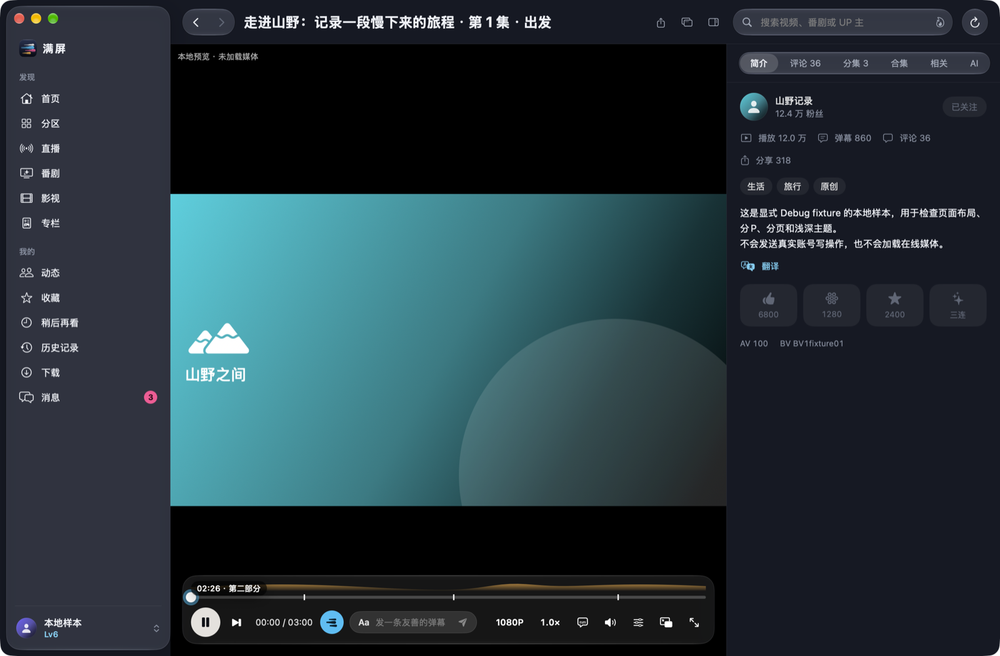
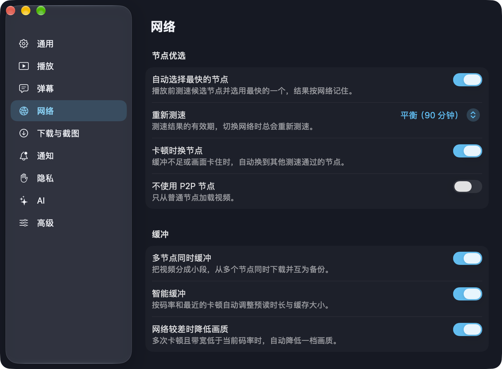
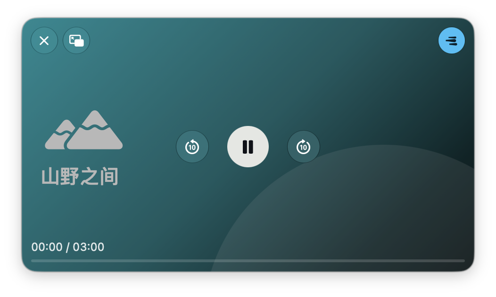

<p align="center"></p>

<h1 align="center">满屏 Manping</h1>

<p align="center">为 Mac 重新打造的第三方哔哩哔哩客户端：原生 SwiftUI / AppKit、mpv 播放、Metal 弹幕。<br>
A native, unofficial Bilibili client for macOS — SwiftUI/AppKit, mpv playback, Metal danmaku.</p>

<p align="center"></p>

> 本项目与哔哩哔哩（上海宽娱数码科技有限公司）没有任何关联，不是官方客户端。视频、弹幕、评论等内容的版权归原作者和平台所有。请遵守哔哩哔哩用户协议与当地法律。

## 特性

- **播放**：mpv + VideoToolbox 硬解，支持 8K、杜比视界、HDR10（EDR 显示）、120 帧；画质与编码偏好、章节、字幕、截图、独立播放窗口与浮动小窗，播放时防止屏幕休眠。
- **弹幕**：Metal 渲染，在独立线程上按每一帧的实际上屏时刻排位，跟随屏幕刷新率（ProMotion 120 Hz）匀速滚动；描边清晰、同行不重叠；支持类型、智能等级、关键词与正则屏蔽，可同步账号的云端屏蔽词；进度条显示弹幕密度。
- **CDN 优选**：多节点测速、多 CDN 并发分段缓冲、卡顿自动换节点、智能缓存与自动降画质。
- **代理 / VPN**：HTTP、SOCKS5 与内置 Shadowsocks，可用于接口的区域解锁；也可在卡顿时或始终经代理并发拉取视频。
- **直播**：App 内播放直播间，支持线路竞速、断线重连、实时弹幕与醒目留言、关注主播开播通知。
- **内容**：推荐、热门、分区、番剧与影视、动态、专栏阅读、评论（发送、回复、点赞）、私信、收藏、稍后再看、历史、下载（含 BBDown 命令导出）。
- **AI**：视频与文章的总结、评价与问答；支持 22 家 API 服务、ChatGPT 套餐登录，以及 Apple 智能可用时的本机模型。
- **Mac 体验**：控制中心与媒体键、Dock 菜单与未读角标、菜单栏常驻项、`manping://` 链接与拖入 B 站链接直达（⌘L）、聚焦搜索看过的内容、接力、实况文本（暂停时选取画面文字）、系统翻译、低电量与发热时自动降级。

<p align="center">




</p>

截图均为内置的离线样本数据（fixture），不含任何真实账号内容。

## 系统要求与构建

- Apple Silicon Mac，macOS 27
- Xcode 27（Swift 6）、Python 3、Homebrew（用于构建 mpv 与 FFmpeg 依赖）

```sh
export DEVELOPER_DIR=/Applications/Xcode.app/Contents/Developer
swift build && swift test          # 编译与测试（只用离线样本，不访问账号）
python3 scripts/build_mpv.py        # 首次：构建固定版本并打补丁的 libmpv
python3 scripts/bundle.py --output "dist/release/满屏.app"
open "dist/release/满屏.app"
```

打包、签名、调试版与诊断工具的完整说明见 [docs/Development.md](docs/Development.md) 和 [docs/Signing.md](docs/Signing.md)。默认使用 ad-hoc 签名；想避免每次重新构建都要授权钥匙串，可以按 Signing.md 创建一个本机签名证书。

## 隐私

满屏没有自己的服务器，不收集任何统计数据。下面这些数据只保存在你的 Mac 上：

| 数据 | 位置 |
|---|---|
| 登录凭据、代理密码、AI 服务密钥、ChatGPT 套餐令牌 | 钥匙串（服务名以 `io.github.pidean.manping` 开头） |
| 设置、固定的直播间与 UP 主、弹幕屏蔽规则、账号屏蔽词缓存 | `~/Library/Preferences/io.github.pidean.manping.plist` |
| AI 服务配置（不含密钥）、下载记录 | `~/Library/Application Support/Manping/` |
| 图片缓存 | `~/Library/Caches/` 下的应用缓存 |
| 聚焦索引（看过的内容，90 天过期） | 系统聚焦；可在 设置 › 隐私 › 聚焦搜索与接力 中关闭并清除 |

### 会发送到外部的数据

满屏只会连接哔哩哔哩的服务器、你自己配置的代理，以及你选择的 AI 服务。下面这些功能会把数据发到本机以外，均可关闭：

| 功能 | 发送什么、发给谁 | 默认 | 如何关闭 |
|---|---|---|---|
| 同步观看进度 | 登录后，把正在看的视频编号和播放进度写入你的 B 站历史记录 | 开 | 设置 › 隐私 › 同步观看进度 |
| 接力 | 正在看的 B 站网页地址和标题，由系统提供给登录同一 Apple 账户的其他设备 | 开 | 设置 › 隐私 › 聚焦搜索与接力（同时关闭聚焦索引）；或在系统设置 › 通用 › 隔空投送与接力 中关闭接力 |
| AI 总结、评价与问答 | 只在你点击时发送：视频的标题、简介、字幕（和评论区摘录）或文章正文，以及你的问题，发给你在 设置 › AI 中配置的服务；使用 ChatGPT 套餐时发给 OpenAI；选「Apple 智能」时只在本机处理 | 未配置服务时不发送 | 不配置 AI 服务即可 |
| 代理 | 你配置的接口或视频请求经由你的代理服务器 | 关 | 设置 › 网络 › 代理 |

退出登录会清除凭据、通知、聚焦索引和账号屏蔽词。诊断日志会自动隐去 Cookie 和令牌。

## 致谢

满屏站在许多开源项目的肩膀上：

**代码、协议与资源来源**（许可证全文见 [ThirdPartyNotices](ThirdPartyNotices)）

- [Bili.Copilot](https://github.com/Richasy/Bili.Copilot)（GPL-3.0）：界面结构、功能对照与 AI 提示词的基准；本项目由此衍生，并因此采用 GPL-3.0。
- [bili-kernel](https://github.com/Richasy/bili-kernel)（GPL-3.0）：gRPC 协议与接口适配参考。
- [agent-kernel](https://github.com/Richasy/agent-kernel)（MIT）、[winui-kernel](https://github.com/Richasy/winui-kernel)：AI 服务配置格式与模型目录。
- [Bili CDN Switcher](https://github.com/liiliiliil/bili-cdn-switcher)（MIT）：CDN 候选、测速与卡顿判定策略。
- [mpv](https://mpv.io)、[FFmpeg](https://ffmpeg.org)、[libplacebo](https://code.videolan.org/videolan/libplacebo)：播放与渲染。
- [Anime4K](https://github.com/bloc97/Anime4K)、[ArtCNN](https://github.com/Artoriuz/ArtCNN)、RAVU、nnedi3、igv 着色器。
- [grpc-swift](https://github.com/grpc/grpc-swift-2)、[swift-protobuf](https://github.com/apple/swift-protobuf)、[SwiftNIO](https://github.com/apple/swift-nio) 等 Swift 包。
- [LobeHub Icons](https://github.com/lobehub/lobe-icons)（MIT）：AI 服务图标；各标识归其商标所有者。

**参考与启发**

- [bilibili-API-collect](https://github.com/SocialSisterYi/bilibili-API-collect)：接口文档。
- [IINA](https://iina.io)：Mac 播放器交互。
- [PiliPlus](https://github.com/bggRGjQaUbCoE/PiliPlus) / [PiliPala](https://github.com/guozhigq/pilipala)：跳过片头片尾、屏蔽等功能思路。
- [Bilibili-Evolved](https://github.com/the1812/Bilibili-Evolved)：高能进度条。
- [BBDown](https://github.com/nilaoda/BBDown)：外部下载命令格式。

## 许可

本项目以 [GPL-3.0](LICENSE) 发布。分发构建产物时须同时提供对应源码，并保留 ThirdPartyNotices 中的全部许可。应用图标为本项目原创，同样以 GPL-3.0 发布。
